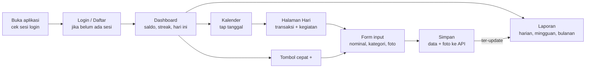
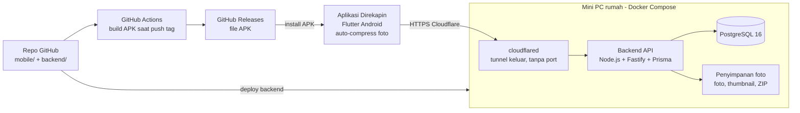

# PRD — Direkapin: Catatan Keuangan & Kegiatan Harian

Versi 4 Nov 2026 (revisi 1) · Owner: Desta

> Sumber kebutuhan untuk Claude Code. Fitur dirujuk dengan ID (FIN-01, US-03, S-08, dst.).
> Kontrak API detail ada di `docs/openapi.yaml`, model data di `backend/prisma/schema.prisma`,
> keputusan teknis di `docs/DECISIONS.md`, aturan UI di `docs/DESIGN.md`.

## 1. Ringkasan produk

**Direkapin** adalah aplikasi Android yang menggabungkan pencatat keuangan harian dan jurnal kegiatan dalam satu kalender. Setiap tanggal di kalender jadi "halaman hari" yang berisi transaksi masuk/keluar (plus foto struk) dan catatan kegiatan (plus foto kegiatan), mirip Google Calendar tapi lebih personal.

**Latar belakang.** Saat ini pencatatan keuangan dan catatan kegiatan tersebar di aplikasi berbeda (atau tidak dicatat sama sekali), jadi susah melihat gambaran utuh satu hari, minggu, atau bulan. Aplikasi pencatat yang membosankan juga bikin kebiasaan mencatat cepat berhenti.

**Konteks rilis.** Dipakai sendiri dulu, lalu dibagikan ke 1–3 teman (maks. 4 user). Aplikasi didistribusikan sebagai APK lewat GitHub Releases (tanpa Play Store). Backend dan database jalan di Docker pada mini PC rumah yang menyala 24 jam, dan diakses publik lewat Cloudflare Tunnel, tanpa VPS.

## 2. Tujuan, pengguna, dan metrik sukses

**Tujuan produk**

1. Melacak arus keuangan harian dengan laporan harian, mingguan, dan bulanan.
2. Menyimpan catatan kegiatan penting beserta fotonya di aplikasi yang sama.
3. Membuat pencatatan harian jadi kebiasaan lewat tampilan yang menarik dan fitur pengingat.

**Target pengguna**

| Persona | Deskripsi | Kebutuhan utama |
| --- | --- | --- |
| Owner (pengguna utama) | Mahasiswa yang ingin mengontrol pengeluaran dan mendokumentasikan kegiatan | Input cepat, laporan jelas, semua data di satu tempat |
| Teman (pengguna berikutnya) | Diundang owner, punya akun dan data sendiri | Daftar akun mudah, data pribadi tidak tercampur dengan user lain |

**Metrik sukses (3 bulan pertama)**

| Metrik | Target |
| --- | --- |
| Hari tercatat per bulan (minimal 1 transaksi atau catatan) | ≥ 25 dari 30 hari |
| Streak pencatatan terpanjang | ≥ 14 hari berturut-turut |
| Waktu input 1 transaksi | ≤ 15 detik |
| Laporan bulanan cocok dengan saldo nyata | Selisih ≤ 5% |

## 3. Ruang lingkup

**In-scope (MVP)**

- Registrasi, login, logout, multi-user dengan data terpisah per akun
- Dashboard ringkasan (saldo per dompet, pemasukan, pengeluaran, kegiatan hari ini, streak)
- Kalender bulanan dengan penanda per tanggal (ada transaksi / ada kegiatan)
- Dompet terpisah (cash, bank, e-wallet) + transfer antar dompet
- CRUD transaksi per tanggal: dompet, tipe, kategori, nominal, catatan, foto struk
- CRUD catatan kegiatan harian: judul, jam (opsional), deskripsi, label penting, foto
- Kompresi foto otomatis di HP sebelum upload (tanpa langkah manual)
- Laporan keuangan harian, mingguan, bulanan (total + grafik + per kategori)
- Kategori bawaan + kategori custom per user
- Notifikasi pengingat harian untuk mencatat
- Arsip foto bulanan yang bisa di-download user
- Distribusi APK via GitHub Releases, backend di mini PC + Cloudflare Tunnel

**Out-of-scope (MVP)**

- Rilis Play Store dan versi iOS
- Sinkronisasi otomatis ke rekening bank / e-wallet
- OCR otomatis isi struk (kandidat fase 2)
- Mode offline penuh dan realtime sync (data di-refresh saat aplikasi dibuka)
- Jadwal kegiatan + reminder per kegiatan
- Berbagi data antar user / dompet bersama
- Multi mata uang (MVP hanya Rupiah)

## 4. Fitur dan kebutuhan fungsional

Prioritas: **P0** wajib di MVP, **P1** setelah MVP stabil, **P2** nice-to-have.

### 4.1 Autentikasi & akun

| ID | Kebutuhan | Prioritas |
| --- | --- | --- |
| AUTH-01 | User daftar dengan nama, email, password (min. 8 karakter) | P0 |
| AUTH-02 | Login email + password, sesi tersimpan (access token + refresh token) | P0 |
| AUTH-03 | Logout dan hapus token dari perangkat | P0 |
| AUTH-04 | Registrasi dibatasi pakai kode undangan (supaya server tidak dipakai orang asing) | P0 |
| AUTH-05 | Edit profil: nama, foto | P1 |
| AUTH-06 | Lupa password via email | P2 |

### 4.2 Dashboard

| ID | Kebutuhan | Prioritas |
| --- | --- | --- |
| DSH-01 | Kartu saldo bulan ini: pemasukan, pengeluaran, selisih | P0 |
| DSH-02 | Ringkasan hari ini: total keluar hari ini + daftar kegiatan hari ini | P0 |
| DSH-03 | Grafik pengeluaran 7 hari terakhir | P0 |
| DSH-04 | Top 5 kategori pengeluaran bulan ini (donut chart) | P1 |
| DSH-05 | Streak pencatatan (hari berturut-turut ada catatan) | P0 |
| DSH-06 | Tombol cepat (FAB): + Transaksi, + Kegiatan | P0 |

### 4.3 Kalender

| ID | Kebutuhan | Prioritas |
| --- | --- | --- |
| CAL-01 | Tampilan bulan; tiap tanggal menampilkan titik warna: hijau (pemasukan), merah (pengeluaran), biru (kegiatan) | P0 |
| CAL-02 | Tampilan minggu dan agenda (list) | P1 |
| CAL-03 | Tap tanggal membuka Halaman Hari: daftar transaksi + kegiatan + total hari itu | P0 |
| CAL-04 | Tambah / edit / hapus transaksi dan kegiatan langsung dari Halaman Hari | P0 |
| CAL-05 | Pindah tanggal transaksi atau kegiatan (edit tanggal) | P0 |
| CAL-06 | Heatmap pengeluaran (warna tanggal makin gelap makin boros) | P2 |

### 4.4 Modul keuangan

| ID | Kebutuhan | Prioritas |
| --- | --- | --- |
| FIN-01 | Tambah transaksi: dompet, tipe (masuk/keluar), nominal, kategori, tanggal, jam, catatan | P0 |
| FIN-02 | Lampirkan foto struk dari kamera atau galeri (maks. 3 foto); kompresi otomatis sesuai FIN-13 | P0 |
| FIN-03 | Edit semua field per transaksi: dompet, kategori, nominal, tanggal, catatan, foto | P0 |
| FIN-04 | Hapus transaksi (dengan konfirmasi) | P0 |
| FIN-05 | Kategori bawaan (Makan, Transport, Kuliah, Hiburan, Belanja, Tagihan, Gaji/Uang saku, Lainnya) + CRUD kategori custom dengan ikon & warna | P0 |
| FIN-06 | Laporan harian: total masuk, keluar, selisih, daftar transaksi | P0 |
| FIN-07 | Laporan mingguan: total per hari (bar chart) + per kategori | P0 |
| FIN-08 | Laporan bulanan: total per minggu/hari, per kategori (donut), perbandingan dengan bulan lalu | P0 |
| FIN-09 | Dompet: CRUD dompet (nama, jenis cash/bank/e-wallet, saldo awal, ikon); saldo tiap dompet dihitung otomatis | P0 |
| FIN-10 | Transfer antar dompet (mis. tarik tunai bank ke cash) tanpa dihitung sebagai pemasukan/pengeluaran | P0 |
| FIN-11 | Filter laporan & transaksi per dompet, kategori, rentang tanggal, kata kunci | P1 |
| FIN-12 | Budget bulanan per kategori + peringatan saat mendekati batas | P1 |
| FIN-13 | Kompresi otomatis: setiap foto (kamera/galeri) langsung di-resize maks. 1600 px dan dikompres ke JPEG/WebP kualitas ~75–80% (target ≤ 400 KB) di HP sebelum upload, tanpa langkah manual dari user | P0 |
| FIN-14 | Export laporan ke CSV / PDF | P2 |
| FIN-15 | Transaksi berulang (mis. kos bulanan) | P2 |

### 4.5 Modul kegiatan

| ID | Kebutuhan | Prioritas |
| --- | --- | --- |
| ACT-01 | Tambah catatan kegiatan: judul, tanggal, jam (opsional), lokasi, deskripsi | P0 |
| ACT-02 | Tandai kegiatan "penting" (bintang) agar menonjol di kalender | P0 |
| ACT-03 | Lampirkan foto kegiatan (maks. 5 foto), dikompres otomatis seperti FIN-13 | P0 |
| ACT-04 | Edit dan hapus kegiatan | P0 |
| ACT-05 | Mood harian (emoji) di Halaman Hari | P1 |
| ACT-06 | Galeri "Kenangan": semua foto kegiatan per bulan | P2 |

### 4.6 Engagement (biar rajin mencatat)

| ID | Kebutuhan | Prioritas |
| --- | --- | --- |
| ENG-01 | Notifikasi lokal pengingat harian di jam yang bisa diatur (default 21:00), dijadwalkan di HP tanpa push server | P0 |
| ENG-02 | Streak + badge sederhana (7, 30, 100 hari) | P1 |
| ENG-03 | Tema terang/gelap dan warna aksen | P1 |
| ENG-04 | Rekap bulanan ala "wrapped": total pengeluaran, kategori terboros, foto kegiatan terbanyak | P2 |

### 4.7 Arsip foto bulanan

Tujuannya menjaga storage mini PC tetap lega tanpa membuat foto lama hilang dari aplikasi.

| ID | Kebutuhan | Prioritas |
| --- | --- | --- |
| ARC-01 | Job harian pukul 02:00 membuat ZIP per user berisi foto asli bulan M-2 + CSV transaksi dan kegiatan bulan itu, jika arsipnya belum ada atau gagal (normalnya terbentuk tanggal 1). Bulan foto mengikuti waktu upload; bulan tanpa foto dilewati | P0 |
| ARC-02 | Thumbnail (±30 KB) tetap disimpan di server, jadi foto lama masih terlihat di kalender dalam resolusi kecil | P0 |
| ARC-03 | Menu "Arsip" di aplikasi: daftar arsip per bulan + tombol download ke folder Download HP; notifikasi lokal saat aplikasi mendeteksi arsip siap, plus pengingat umum tiap tanggal 1 pukul 09.00 | P0 |
| ARC-04 | Foto asli dihapus setelah ZIP selesai di-download utuh, atau maksimal 30 hari setelah arsip dibuat, dengan pengingat lokal di hari ke-7 dan ke-25. ZIP tetap bisa di-download ulang sampai hari ke-30, lalu dihapus | P0 |
| ARC-05 | Data teks (transaksi, kegiatan) tidak dihapus, tetap permanen di database | P0 |
| ARC-06 | Arsip dijalankan lebih awal jika pemakaian disk > 80% | P1 |

## 5. User flow utama



Halaman Hari jadi pusat aplikasi: semua transaksi dan kegiatan di satu tanggal bisa dilihat, ditambah, dan diedit dari sana.

**Skenario kunci**

1. **Catat pengeluaran cepat:** Dashboard → tombol + → isi nominal, pilih kategori, foto struk → Simpan (maks. 3 tap + input).
2. **Koreksi transaksi lama:** Kalender → tap tanggal → tap transaksi → ubah kategori/nominal/tanggal → Simpan → laporan otomatis menyesuaikan.
3. **Catat kegiatan penting:** Kalender → tap tanggal → + Kegiatan → judul, jam, tandai penting, lampirkan foto → Simpan.
4. **Cek laporan:** Tab Laporan → pilih Harian / Mingguan / Bulanan → geser periode → lihat total, grafik, dan breakdown kategori.

## 6. Kebutuhan non-fungsional

| Aspek | Kebutuhan |
| --- | --- |
| Platform | Android 8.0 (API 26) ke atas, orientasi portrait |
| Performa | Buka aplikasi ≤ 2 detik; load kalender 1 bulan ≤ 1 detik; API p95 ≤ 500 ms |
| Keamanan | HTTPS via Cloudflare; password di-hash bcrypt; JWT access token 15 menit + refresh token 30 hari; token disimpan di secure storage; port database tidak pernah diekspos ke internet |
| Isolasi data | Setiap query difilter `userId` dari token; user tidak bisa akses data atau foto user lain |
| Foto | Kompresi otomatis di HP (FIN-13); server menolak file > 2 MB dan me-resize ulang file > 1 MB dengan `sharp` sebagai pengaman; thumbnail dibuat saat upload; foto diakses lewat endpoint ber-token |
| Sumber daya | Total container Direkapin dibatasi `mem_limit` ± 1 GB agar tidak mengganggu container lain di mini PC |
| Keandalan | Backup database harian (pg_dump, simpan 14 hari) + salinan mingguan ke disk eksternal / cloud; mini PC auto-start setelah mati listrik |
| Rate limit | Login maks. 10 percobaan / 15 menit per IP |
| Usability | Input transaksi maks. 3 tap dari dashboard; nominal pakai keyboard angka dengan format Rupiah otomatis |
| Bahasa | UI bahasa Indonesia; zona waktu Asia/Jakarta (disimpan per user) |
| Skala | Maks. 4 user; estimasi foto ±180 MB/bulan total (setelah kompresi) |

## 7. Arsitektur dan tech stack

Keputusannya: Flutter untuk aplikasi Android, Node.js + PostgreSQL untuk backend, semua jalan di Docker pada mini PC rumah dan diakses publik lewat Cloudflare Tunnel. Backend custom dipilih (bukan Supabase) supaya tidak terikat satu platform dan lebih ringan di RAM.



Aplikasi hanya bicara ke API lewat HTTPS Cloudflare; router rumah tidak membuka port, dan database serta folder foto tidak pernah diakses langsung dari HP.

| Lapisan | Pilihan | Alasan |
| --- | --- | --- |
| Mobile | Flutter 3 (Dart) | Satu codebase, UI gampang dibuat menarik, build APK sederhana |
| Package mobile | lihat `docs/DECISIONS.md` (dependency disetujui) | Kalender, grafik, kamera + kompresi otomatis, notifikasi, HTTP, token aman, state management |
| Backend | Node.js 22 LTS + TypeScript + Fastify 5 | Ringan, cepat, banyak referensi |
| ORM | Prisma 6 | Migrasi skema dan query type-safe; versi dikunci (D-18) |
| Database | PostgreSQL 16 | Relasional, kuat untuk agregat laporan |
| Olah gambar server | `sharp` | Thumbnail + resize ulang sebagai pengaman |
| Job terjadwal | `node-cron` di service API | Backup harian + arsip bulanan |
| Penyimpanan foto | Folder di SSD mini PC (volume Docker) | 512 GB cukup untuk bertahun-tahun |
| Auth | JWT + refresh token, bcrypt | Standar, stateless, multi-device |
| Infra | Docker Compose di mini PC + Cloudflare Tunnel (`cloudflared`) | Gratis, tembus CGNAT, HTTPS otomatis, tanpa VPS |
| CI/CD | GitHub Actions | Build APK dan rilis otomatis |
| Integrasi Claude | MCP server Postgres (user DB read-only terpisah) | Claude bisa membaca skema dan membantu migrasi saat diminta |

Karena semuanya di Docker, stack yang sama bisa dipindah ke VPS kapan pun hanya dengan menyalin folder project, `.env`, dan backup database.

## 8. Desain data (PostgreSQL)

Model lengkap dan final ada di `backend/prisma/schema.prisma`. Ringkasan:

| Tabel | Kolom utama | Catatan |
| --- | --- | --- |
| `users` | id (UUID), name, email (unique), passwordHash, avatarPath, timezone, reminderTime | Satu baris per akun |
| `invite_codes` | code, createdById, usedById, expiresAt, usedAt | Untuk membatasi registrasi |
| `refresh_tokens` | id, userId, tokenHash, expiresAt, revokedAt | Untuk login tetap aktif, dirotasi tiap refresh |
| `wallets` | id, userId, name, type (CASH/BANK/EWALLET), initialBalance, icon, color, isArchived | Saldo = initialBalance + masuk − keluar ± transfer (dihitung, tidak disimpan) |
| `categories` | id, userId, name, type (INCOME/EXPENSE), icon, color, isDefault, isHidden | Kategori bawaan disalin per user saat registrasi + custom |
| `transactions` | id, userId, walletId, categoryId, type, amount (BigInt), occurredAt (timestamptz), note | Index: (userId, occurredAt), (walletId) |
| `transfers` | id, userId, fromWalletId, toWalletId, amount, occurredAt, note | Tidak masuk laporan pemasukan/pengeluaran |
| `activities` | id, userId, title, date, time (nullable), location, description, isImportant | Index: (userId, date) |
| `attachments` | id, userId, transactionId / activityId (tepat satu terisi), filePath (null setelah diarsip), thumbPath, sizeBytes, width, height, archivedAt | Foto struk & foto kegiatan |
| `archives` | id, userId, month, zipPath (null jika gagal), sizeBytes, photoCount, status (READY/DOWNLOADED/EXPIRED/FAILED), createdAt, downloadedAt, expiresAt | Arsip foto bulanan |
| `daily_notes` | id, userId, date (unique per user), mood, note | Mood & catatan singkat per hari (P1) |
| `budgets` | id, userId, categoryId, month, limitAmount | Budget per kategori (P1) |

**Relasi:** satu user punya banyak wallets, categories, transactions, activities; satu transaction/activity punya 0–N attachments. Laporan harian/mingguan/bulanan dihitung dengan query agregat dari `transactions`, jadi tidak perlu tabel laporan terpisah.

## 9. API endpoint (REST, prefix `/api/v1`)

Kontrak detail (request, response, error) ada di `docs/openapi.yaml`. Semua endpoint kecuali auth, `/health`, dan `/version` butuh header `Authorization: Bearer <token>`.

| Method | Endpoint | Fungsi |
| --- | --- | --- |
| GET | `/health` | Cek server hidup |
| GET | `/version` | Versi APK terbaru + link GitHub Release |
| POST | `/auth/register` | Daftar (nama, email, password, kode undangan) |
| POST | `/auth/login` | Login, balikin access + refresh token |
| POST | `/auth/refresh` | Tukar refresh token jadi access token baru |
| POST | `/auth/logout` | Cabut refresh token |
| GET / PATCH | `/me` | Lihat / ubah profil dan jam reminder |
| GET / POST | `/wallets` | List dompet (dengan saldo) / tambah dompet |
| PATCH / DELETE | `/wallets/{id}` | Ubah / arsipkan / hapus dompet |
| GET / POST | `/transfers` | Riwayat transfer / transfer antar dompet |
| PATCH / DELETE | `/transfers/{id}` | Edit / hapus transfer |
| GET / POST | `/categories` | List / tambah kategori |
| PATCH / DELETE | `/categories/{id}` | Ubah / hapus kategori custom |
| GET | `/transactions?from=&to=&wallet=&category=&type=&q=` | List transaksi dengan filter |
| POST | `/transactions` | Tambah transaksi |
| GET / PATCH / DELETE | `/transactions/{id}` | Detail / edit / hapus |
| GET | `/activities?from=&to=` | List kegiatan |
| POST | `/activities` | Tambah kegiatan |
| GET / PATCH / DELETE | `/activities/{id}` | Detail / edit / hapus kegiatan |
| POST | `/attachments` | Upload foto yang sudah dikompres (multipart, field `transactionId` atau `activityId`) |
| GET | `/attachments/{id}?size=thumb\|full` | Ambil thumbnail atau foto asli |
| DELETE | `/attachments/{id}` | Hapus foto |
| GET | `/calendar?month=2026-11` | Penanda per tanggal: total masuk, keluar, jumlah kegiatan |
| GET | `/days/{date}` | Isi Halaman Hari: transaksi, transfer, kegiatan, foto, mood |
| GET | `/reports/daily?date=&wallet=` | Laporan harian |
| GET | `/reports/weekly?start=&wallet=` | Laporan mingguan (per hari + per kategori) |
| GET | `/reports/monthly?month=&wallet=` | Laporan bulanan (per hari, per kategori, vs bulan lalu) |
| GET | `/dashboard` | Data ringkasan dashboard + streak |
| GET | `/archives` | Daftar arsip bulanan milik user |
| GET | `/archives/{id}/download` | Download ZIP arsip (status jadi downloaded setelah unduhan selesai utuh) |

## 10. Deployment dan distribusi

**Backend di mini PC (Docker)**

1. Mini PC (12 GB RAM, SSD 512 GB, Intel Celeron) menyala 24 jam; atur BIOS agar otomatis menyala setelah mati listrik dan Docker auto-start saat boot.
2. `docker compose` berisi 3 service: `api` (Node.js), `db` (PostgreSQL 16), `cloudflared` (Cloudflare Tunnel). Semua pakai `restart: unless-stopped` dan `mem_limit`.
3. Beli domain (mis. `direkapin.my.id`), pindahkan DNS ke Cloudflare (free plan), buat tunnel di Zero Trust, lalu arahkan `api.direkapin.my.id` ke `http://api:3000`.
4. Tidak ada port yang dibuka di router; port database hanya di jaringan internal Docker.
5. Token tunnel dan secret lain disimpan di `.env`, tidak di-commit ke GitHub.
6. Foto disimpan di volume `/data/uploads`, arsip ZIP di `/data/archives`.
7. Job terjadwal: `pg_dump` tiap hari pukul 01:00 (simpan 14 hari), salin backup + arsip ke disk eksternal / cloud tiap minggu, job arsip foto tiap hari pukul 02:00 (membuat arsip M-2 yang belum ada atau gagal, lalu membereskan yang kedaluwarsa).
8. Integrasi Claude: buat user Postgres read-only khusus untuk MCP server Postgres, dipakai dari laptop lewat jaringan lokal saja.

**Aplikasi Android via GitHub**

1. Repo GitHub (monorepo): folder `mobile/` (Flutter) dan `backend/` (Node.js).
2. GitHub Actions: tiap push tag `v*` → build APK release (signed dengan keystore di GitHub Secrets) → upload otomatis ke GitHub Releases.
3. User download APK dari halaman Releases dan izinkan "Install dari sumber tidak dikenal".
4. Aplikasi cek endpoint `/api/v1/version` saat dibuka; kalau ada versi baru, tampilkan banner dengan link ke Release terbaru.
5. URL API diset lewat build config (`--dart-define=API_URL=...`), bukan di-hardcode.

## 11. Roadmap dan milestone

MVP siap dipakai sendiri dalam ±8 minggu, lalu dibagikan ke teman.

| Fase | Waktu | Isi |
| --- | --- | --- |
| 1. Fondasi | Minggu 1–2 | Repo + GitHub Actions, Docker + Cloudflare Tunnel, skema DB + API auth |
| 2. Inti keuangan | Minggu 3–4 | Dompet + transaksi, kategori + foto struk, dashboard |
| 3. Kalender | Minggu 5–6 | Kalender bulanan, Halaman Hari, kegiatan + foto |
| 4. Rilis v1.0 | Minggu 7–8 | Laporan 3 periode, reminder + arsip foto, APK v1.0 di GitHub |
| **Gate** | — | Dipakai sendiri 14 hari tanpa bug kritis |
| 5. Setelah MVP | Minggu 9+ | Undang teman, budget per kategori, mood harian, badge streak, export CSV/PDF, OCR struk |

Durasi adalah estimasi untuk dikerjakan sendiri sambil kuliah (±10 jam/minggu); fitur P0 masuk fase 1–4, fitur P1/P2 di fase 5. Urutan pengerjaan per sesi Claude Code ada di `docs/TASKS.md`.

## 12. Risiko dan keputusan

| Risiko | Dampak | Mitigasi |
| --- | --- | --- |
| Mini PC mati, listrik padam, atau internet rumah putus | Aplikasi tidak bisa simpan/ambil data | Auto power-on di BIOS, Docker auto-start; opsional UPS kecil; aplikasi menampilkan pesan "server offline" yang jelas |
| Disk mini PC rusak | Semua data hilang | Backup harian + salinan mingguan ke disk eksternal / cloud, uji restore tiap bulan |
| RAM mini PC rebutan dengan container lain | Aplikasi lambat atau crash | `mem_limit` per container, pantau dengan `docker stats` |
| User lupa download arsip | Foto asli bulan itu hilang | Notifikasi lokal saat arsip terdeteksi + pengingat hari ke-7 dan ke-25 + pengingat umum tiap tanggal 1. Tanpa push server, pengingat spesifik baru terpasang setelah aplikasi dibuka |
| Kebocoran data antar user | Privasi teman terbuka | Filter `userId` di semua query, uji akses silang, foto lewat endpoint ber-token |
| API terbuka ke internet | Serangan brute force / spam akun | Kode undangan, rate limit login, Cloudflare WAF bawaan |
| APK tidak resmi diblokir Play Protect | Teman ragu install | Signing konsisten pakai keystore yang sama, jelaskan cara install di README |
| Semangat mencatat turun | Tujuan utama gagal | Reminder harian, streak, input cepat ≤ 15 detik |

**Keputusan yang sudah diambil**

| Topik | Keputusan |
| --- | --- |
| Nama aplikasi | Direkapin; domain menyusul (mis. `direkapin.my.id`) |
| Dompet | Dompet terpisah (cash, bank, e-wallet) masuk MVP |
| Kegiatan | Cukup catatan harian; jadwal + reminder per kegiatan tidak di MVP |
| Jumlah user | Owner + 1–3 teman (maks. 4 user) |
| Hosting | Docker di mini PC rumah + Cloudflare Tunnel, tanpa VPS |
| Backend | Node.js + PostgreSQL (bukan Supabase), agar tidak terikat platform |
| Foto | Kompresi otomatis di HP + arsip bulanan dengan thumbnail tetap tersimpan |
| Notifikasi | Lokal di HP, tanpa push server / Firebase |

## 13. User story dan acceptance criteria

Format: *Sebagai user, saya ingin … supaya …*, lalu kriteria yang harus lolos agar story dianggap selesai.

**US-01 — Daftar dengan kode undangan** (AUTH-01, AUTH-04)
Sebagai teman owner, saya ingin daftar pakai kode undangan supaya bisa punya akun sendiri.
- Kode valid, belum dipakai, belum kedaluwarsa → akun dibuat, kode ditandai terpakai, user langsung login.
- Kode salah/terpakai/kedaluwarsa → pesan "Kode undangan tidak valid", akun tidak dibuat.
- Email sudah terdaftar → pesan "Email sudah dipakai".
- Akun baru otomatis punya 1 dompet "Cash" (saldo 0) dan kategori bawaan.

**US-02 — Login tetap aktif** (AUTH-02)
Sebagai user, saya ingin tidak perlu login ulang setiap buka aplikasi.
- Access token kedaluwarsa → aplikasi diam-diam refresh tanpa user sadar.
- Refresh token kedaluwarsa (30 hari tidak dibuka) → diarahkan ke layar login.
- 10 kali gagal login dalam 15 menit → dikunci sementara, pesan menyebut sisa waktu.

**US-03 — Catat pengeluaran cepat** (DSH-06, FIN-01, FIN-13)
Sebagai user, saya ingin mencatat pengeluaran dalam hitungan detik supaya tidak malas mencatat.
- Dari dashboard, tombol + → form terbuka dengan tanggal hari ini, tipe "Keluar", dan dompet terakhir dipakai sudah terpilih.
- Simpan hanya butuh nominal + kategori; field lain opsional.
- Setelah simpan, saldo dompet, dashboard, dan penanda kalender langsung ter-update.

**US-04 — Foto struk tanpa ribet** (FIN-02, FIN-13)
Sebagai user, saya ingin foto struk langsung dari kamera tanpa compress manual.
- Foto 3–5 MB dari kamera tersimpan di server sebagai file ≤ 400 KB dengan lebar maks. 1600 px.
- Selama kompres + upload, ada progress; transaksi tetap tersimpan walau upload foto gagal, dengan tombol "Coba upload lagi".
- Thumbnail tampil di daftar transaksi; tap thumbnail membuka foto penuh.

**US-05 — Koreksi transaksi lama** (CAL-03, FIN-03, CAL-05)
Sebagai user, saya ingin mengubah kategori, nominal, dompet, atau tanggal transaksi yang salah input.
- Semua field bisa diedit dari Halaman Hari.
- Pindah tanggal → transaksi hilang dari tanggal lama dan muncul di tanggal baru; laporan kedua periode ikut berubah.
- Hapus transaksi minta konfirmasi; foto ikut terhapus dari server.

**US-06 — Kelola dompet dan transfer** (FIN-09, FIN-10)
Sebagai user, saya ingin memisahkan uang cash, bank, dan e-wallet.
- Saldo tiap dompet = saldo awal + pemasukan − pengeluaran ± transfer, dan selalu sama dengan jumlah transaksinya.
- Transfer Rp100.000 dari Bank ke Cash → Bank berkurang, Cash bertambah, total saldo tetap, laporan pemasukan/pengeluaran tidak berubah.
- Dompet yang punya transaksi tidak bisa dihapus, hanya diarsipkan (disembunyikan dari pilihan).

**US-07 — Lihat laporan** (FIN-06, FIN-07, FIN-08)
Sebagai user, saya ingin melihat ke mana uang saya pergi per hari, minggu, dan bulan.
- Tab Laporan punya pilihan Harian / Mingguan / Bulanan dan bisa geser ke periode sebelumnya/berikutnya.
- Minggu dihitung Senin–Minggu.
- Total di laporan sama persis dengan jumlah transaksi di periode itu; transfer tidak dihitung.
- Bisa difilter per dompet atau "Semua dompet".

**US-08 — Catat kegiatan penting** (ACT-01–ACT-04)
Sebagai user, saya ingin menyimpan kegiatan penting beserta fotonya di tanggalnya.
- Kegiatan bertanda penting tampil dengan bintang di kalender dan paling atas di Halaman Hari.
- Maks. 5 foto; foto ke-6 ditolak dengan pesan jelas.

**US-09 — Pengingat harian** (ENG-01)
Sebagai user, saya ingin diingatkan mencatat setiap malam.
- Notifikasi muncul di jam yang diatur (default 21:00), walau aplikasi ditutup. Jadwal 30 hari ke depan dipasang ulang setiap aplikasi dibuka, catatan disimpan, atau jam diubah.
- Jika hari itu sudah ada catatan yang diketahui HP ini, notifikasi hari itu tidak muncul.
- Tap notifikasi membuka Halaman Hari tanggal hari ini.

**US-10 — Download arsip foto** (ARC-01–ARC-04)
Sebagai user, saya ingin menyimpan foto lama ke HP sebelum dihapus dari server.
- Tanggal 1 ada pengingat umum untuk cek arsip; saat aplikasi dibuka dan mendeteksi arsip baru, ada notifikasi "Arsip bulan X siap".
- Tap Download → ZIP tersimpan di folder Download/Direkapin, status berubah "Sudah di-download". Unduhan terputus tidak mengubah status dan foto asli tetap ada.
- ZIP bisa di-download ulang sampai hari ke-30 setelah arsip dibuat.
- Setelah arsip dibuat, foto lama tetap tampil sebagai thumbnail; buka foto penuh menampilkan info "Foto asli ada di arsip bulan X".

## 14. Spesifikasi layar

Navigasi utama pakai bottom navigation 4 tab: **Beranda · Kalender · Laporan · Profil**, plus tombol + (FAB) di Beranda dan Kalender.

| Kode | Layar | Isi utama | Aksi / navigasi |
| --- | --- | --- | --- |
| S-01 | Splash | Logo Direkapin, cek sesi + cek versi (`/version`) | Ada sesi → S-04; tidak ada → S-02; versi baru → banner update |
| S-02 | Login | Email, password, tombol Masuk, link Daftar | Berhasil → S-04 |
| S-03 | Daftar | Nama, email, password, kode undangan | Berhasil → S-04 |
| S-04 | Beranda (Dashboard) | Kartu total saldo + saldo per dompet (scroll horizontal), masuk/keluar bulan ini, streak, grafik 7 hari, kegiatan hari ini | FAB → S-08 / S-09; tap dompet → S-12 |
| S-05 | Kalender | Grid bulan, titik hijau/merah/biru, bintang untuk kegiatan penting, total keluar per tanggal (kecil) | Geser bulan; tap tanggal → S-06 |
| S-06 | Halaman Hari | Tanggal, mood (P1), ringkasan masuk/keluar, daftar kegiatan (penting di atas), daftar transaksi dengan thumbnail | + Transaksi → S-08; + Kegiatan → S-09; tap item → S-07 |
| S-07 | Detail item | Semua field + galeri foto penuh | Edit → S-08 / S-09; Hapus (konfirmasi) |
| S-08 | Form transaksi | Toggle Keluar/Masuk/Transfer, nominal (keyboard angka), dompet, kategori (grid ikon), tanggal & jam, catatan, foto (kamera/galeri) | Simpan → kembali ke layar asal + snackbar |
| S-09 | Form kegiatan | Judul, tanggal, jam (opsional), lokasi, deskripsi, toggle penting, foto | Simpan → kembali ke layar asal |
| S-10 | Laporan | Tab Harian/Mingguan/Bulanan, navigasi periode, filter dompet, total, grafik, breakdown kategori | Tap kategori → daftar transaksi kategori itu |
| S-11 | Kategori | Daftar kategori masuk/keluar, tambah/edit (nama, ikon, warna) | — |
| S-12 | Dompet | Daftar dompet + saldo, tambah/edit/arsipkan, riwayat transfer | Tap dompet → transaksi dompet itu |
| S-13 | Arsip | Daftar arsip per bulan, ukuran, status, sisa hari sebelum foto asli dihapus | Download ZIP |
| S-14 | Profil & Pengaturan | Nama, foto, jam reminder, tema terang/gelap, menu Kategori, Dompet, Arsip, Logout | Ke S-11, S-12, S-13 |

**State yang wajib ditangani di setiap layar:** loading (skeleton), kosong (ilustrasi + ajakan mencatat), error jaringan / server offline (pesan + tombol coba lagi).

## 15. Aturan bisnis dan validasi

**Validasi input**

| Field | Aturan | Pesan error |
| --- | --- | --- |
| Nama | 2–50 karakter | "Nama minimal 2 karakter" |
| Email | Format email valid, unik | "Email tidak valid" / "Email sudah dipakai" |
| Password | Min. 8 karakter, ada huruf dan angka | "Password minimal 8 karakter dengan huruf dan angka" |
| Nominal | Bilangan bulat Rp1 – Rp999.999.999 | "Nominal harus lebih dari 0" |
| Tanggal transaksi/kegiatan | Tidak boleh lebih dari 1 tahun ke depan | "Tanggal terlalu jauh ke depan" |
| Kategori | Wajib untuk transaksi masuk/keluar; tipe kategori harus cocok dengan tipe transaksi | "Pilih kategori" |
| Dompet | Wajib, milik user, tidak diarsipkan | "Pilih dompet" |
| Transfer | Dompet asal ≠ dompet tujuan | "Dompet asal dan tujuan harus berbeda" |
| Judul kegiatan | 1–100 karakter | "Judul wajib diisi" |
| Catatan / deskripsi | Maks. 1.000 karakter | "Catatan terlalu panjang" |
| Foto | JPEG/PNG/WebP/HEIC (HEIC dikonversi di HP); struk maks. 3, kegiatan maks. 5; server tolak > 2 MB setelah kompres | "Maksimal 3 foto" / "Format foto tidak didukung" |
| Nama dompet / kategori | 1–30 karakter, unik per user | "Nama sudah dipakai" |

**Aturan bisnis**

1. **Saldo** dompet tidak disimpan, selalu dihitung dari saldo awal + transaksi + transfer, supaya tidak pernah selisih.
2. **Saldo negatif** diizinkan (mis. utang di e-wallet) tapi ditampilkan merah.
3. **Transfer** tidak masuk laporan pemasukan/pengeluaran dan tidak punya kategori.
4. **Hapus kategori custom** yang sudah dipakai → transaksinya dipindah ke "Lainnya" (tipe sama). Kategori bawaan tidak bisa dihapus, hanya disembunyikan.
5. **Hapus dompet** hanya boleh kalau belum ada transaksi/transfer; selain itu diarsipkan.
6. **Streak** bertambah jika dalam satu hari (zona waktu user) ada minimal 1 transaksi atau kegiatan; putus jika ada hari kosong.
7. **Minggu** dihitung Senin–Minggu; **bulan** mengikuti kalender (tanggal 1 sampai akhir bulan).
8. **Waktu** disimpan dalam UTC di database, ditampilkan sesuai zona waktu user (default Asia/Jakarta).
9. **Arsip** bulan M-2 dibuat oleh job harian (normalnya tanggal 1). Bulan foto mengikuti waktu upload di zona waktu user; bulan tanpa foto dilewati. Foto asli dihapus setelah ZIP selesai di-download utuh atau pada hari ke-30; ZIP dihapus pada hari ke-30. Jika gagal membuat ZIP, status arsip `FAILED`, foto tidak dihapus, dan job dicoba lagi besok.
10. **Kepemilikan data**: setiap akses ke data milik user lain dibalas 404 (bukan 403) supaya ID data orang lain tidak bisa ditebak.

## 16. Struktur project dan konfigurasi

**Struktur repo (monorepo)**

```text
direkapin/
├── mobile/                  # Flutter app (konvensi: mobile/CLAUDE.md)
├── backend/                 # Node.js + Fastify + Prisma (konvensi: backend/CLAUDE.md)
│   └── prisma/schema.prisma
├── docs/
│   ├── PRD.md
│   ├── openapi.yaml
│   ├── DESIGN.md
│   ├── DECISIONS.md
│   └── TASKS.md
├── docker-compose.yml
├── .env.example
├── .github/workflows/release-apk.yml
├── CLAUDE.md
└── README.md                # cara install APK + setup server
```

**Environment variable** — lengkap di `.env.example` (tidak ada secret yang di-commit).

**docker-compose.yml (gambaran)**

```yaml
services:
  api:
    build: ./backend
    env_file: .env
    volumes:
      - ./data:/data
    depends_on: [db]
    restart: unless-stopped
    mem_limit: 512m
  db:
    image: postgres:16-alpine
    environment:
      POSTGRES_USER: direkapin
      POSTGRES_DB: direkapin
      POSTGRES_PASSWORD: ${POSTGRES_PASSWORD}
    volumes:
      - pgdata:/var/lib/postgresql/data
    restart: unless-stopped
    mem_limit: 512m
  cloudflared:
    image: cloudflare/cloudflared:latest
    command: tunnel run
    environment:
      TUNNEL_TOKEN: ${CF_TUNNEL_TOKEN}
    restart: unless-stopped
    mem_limit: 128m
volumes:
  pgdata:
```

Port database tidak di-publish ke internet. Docker hanya dijalankan di mini PC, dan data asli hanya ada di sana. Saat dev dan test, API dijalankan langsung di laptop (`npm run dev`) dengan PostgreSQL 16 yang ter-install di laptop, berisi data palsu. Untuk MCP Claude dari laptop, buka port 5432 hanya ke jaringan lokal (bind ke IP LAN mini PC) dan pakai user Postgres read-only.

## 17. Rencana testing

| Level | Alat | Fokus | Target |
| --- | --- | --- | --- |
| Unit backend | Vitest | Hitung saldo, agregat laporan, streak, validasi, job arsip | Coverage modul inti ≥ 70% |
| Integrasi API | Vitest + Fastify inject + Postgres test (di laptop) | Semua endpoint, terutama isolasi data antar user | Semua endpoint punya minimal 1 test sukses + 1 test gagal + 1 test akses user lain |
| Unit & widget mobile | `flutter_test` | Format Rupiah, kompres foto, form validasi, kalender | Layar form dan kalender ter-cover |
| Manual (HP asli) | 2 HP Android berbeda | Alur kamera, upload di jaringan lemah, notifikasi, install APK dari GitHub | Checklist rilis lolos semua |

**Skenario wajib sebelum rilis v1.0**

- [ ] User A tidak bisa membuka transaksi, foto, atau arsip milik user B (dicoba dengan ID asli user B)
- [ ] Foto kamera 5 MB tersimpan ≤ 400 KB dan thumbnail muncul
- [ ] Upload foto gagal (mode pesawat) → transaksi tetap tersimpan, bisa upload ulang
- [ ] Total laporan bulanan = jumlah manual transaksi bulan itu; transfer tidak terhitung
- [ ] Saldo semua dompet setelah 50 transaksi + 5 transfer sesuai hitungan manual
- [ ] Edit tanggal transaksi memindahkan penanda kalender dan mengubah laporan kedua periode
- [ ] Job arsip berjalan (dipicu manual): ZIP berisi foto + CSV, thumbnail tetap tampil, foto asli terhapus setelah download
- [ ] Download arsip diputus di tengah → status tidak berubah, foto asli utuh, bisa download ulang
- [ ] Pembuatan ZIP gagal → status `FAILED`, foto asli utuh, job hari berikutnya berhasil
- [ ] Restore backup `pg_dump` ke database kosong berhasil dan data lengkap
- [ ] Mini PC di-restart → semua container dan tunnel hidup lagi otomatis
- [ ] Notifikasi pengingat muncul di jam yang diatur dan tidak muncul jika hari itu sudah mencatat

## 18. Definition of Done dan glosarium

**Sebuah fitur dianggap selesai jika:**

- [ ] Semua acceptance criteria di user story-nya lolos
- [ ] Endpoint punya validasi, cek kepemilikan `userId`, dan test integrasi
- [ ] Layar menangani state loading, kosong, dan error
- [ ] Migrasi Prisma ter-commit dan bisa dijalankan di database kosong
- [ ] Dicoba di HP Android asli lewat APK release, bukan hanya emulator
- [ ] README diperbarui jika ada setup atau env baru

**v1.0 dianggap rilis jika** semua fitur P0 selesai, checklist skenario di bagian 17 lolos, dan APK ter-upload di GitHub Releases.

**Glosarium**

| Istilah | Arti |
| --- | --- |
| Halaman Hari | Layar berisi semua transaksi, kegiatan, dan foto pada satu tanggal |
| Dompet | Tempat uang disimpan (cash, rekening bank, e-wallet), masing-masing punya saldo |
| Transfer | Perpindahan uang antar dompet milik user sendiri; bukan pemasukan/pengeluaran |
| Streak | Jumlah hari berturut-turut user punya minimal 1 catatan |
| Arsip | ZIP bulanan berisi foto asli + CSV data, untuk di-download ke HP |
| Thumbnail | Versi kecil foto (±30 KB) yang tetap disimpan di server setelah diarsip |
| Cloudflare Tunnel | Koneksi keluar dari mini PC ke Cloudflare yang membuat API bisa diakses publik tanpa buka port |
| MCP | Model Context Protocol, cara Claude terhubung ke database untuk membaca skema dan membantu migrasi |
| P0 / P1 / P2 | Prioritas: wajib MVP / setelah MVP / nice-to-have |
